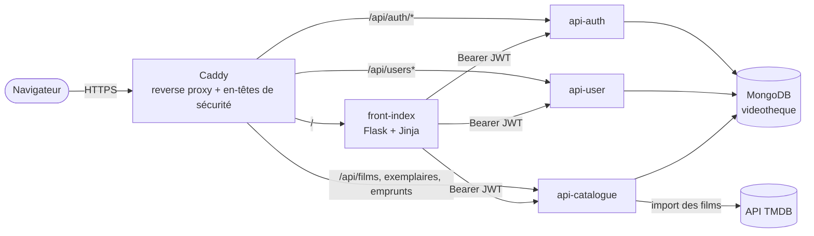
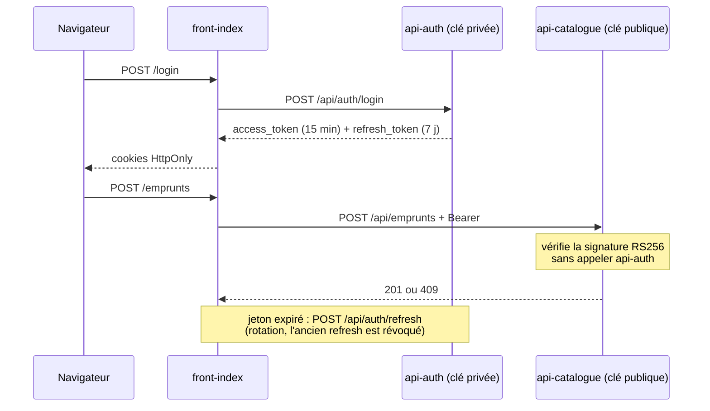
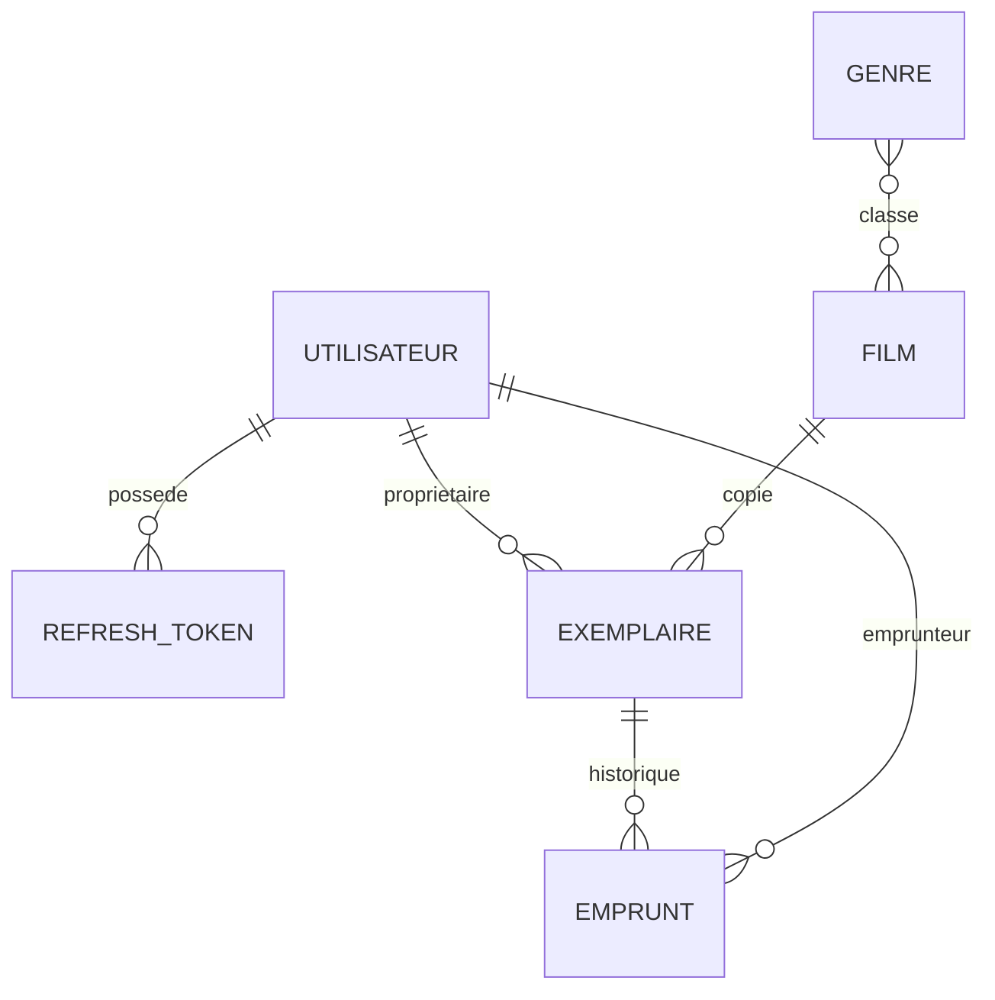
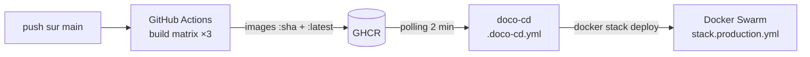

# Vidéothèque · back-end (microservices)

**Application de prêt de films entre membres, découpée en trois API Flask (authentification, utilisateurs, catalogue), MongoDB et un reverse proxy Caddy, déployée sur Docker Swarm par une chaîne CI/CD GitHub Actions → GHCR.**

[](https://github.com/LOIC-only-one/projet-m705-serveur/actions/workflows/ci-cd.yml)


Projet du module M705. Front-end : [projet-m705-client](https://github.com/LOIC-only-one/projet-m705-client).

---

## Architecture



- Le navigateur ne parle qu'au front ; les API ne renvoient que du JSON, avec des erreurs toujours au format `{"error": {"code", "message"}}`.
- Chaque API publie sa documentation OpenAPI (`/api/auth/docs`, `/api/catalogue/docs`).
- Le détail des échanges et des collections est dans [MODELISATION.md](MODELISATION.md).

## Authentification



- **RS256** : seul `api-auth` détient la clé privée ; les autres services vérifient les jetons avec la clé publique.
- **Mots de passe** hachés avec Argon2 ; limitation de débit sur les routes d'authentification (Flask-Limiter).
- **Refresh tokens** stockés par `jti` : déconnexion = révocation, et chaque refresh n'est utilisable qu'une fois.

## Modèle de données



Un **film** est la fiche commune (importée de TMDB) ; un **exemplaire** est la copie d'un membre. L'emprunt réserve un exemplaire libre en une seule opération atomique : deux demandes simultanées ne peuvent pas prendre la même copie.

**Règles d'emprunt** : pas son propre film, pas deux fois le même, pas un film pas encore sorti, 5 emprunts maximum, aucun nouvel emprunt en cas de retard, 14 jours prolongeables une fois de 7 jours.

## API

| Service | Routes |
|---|---|
| `api-auth` | `POST /api/auth/register` · `login` · `refresh` · `logout` |
| `api-user` | `GET /api/users` (admin) · `GET/PATCH/DELETE /api/users/<id>` · `POST /api/users/<id>/password` |
| `api-catalogue` | `GET /api/films` · `GET /api/films/<tmdb_id>` · `GET/POST /api/exemplaires` · `DELETE /api/exemplaires/<id>` · `GET/POST /api/emprunts` · `POST /api/emprunts/<id>/prolongation` · `POST /api/emprunts/<id>/retour` |

Chaque service expose aussi `GET /health`.

---

## Lancer en local

Les deux dépôts doivent être clonés côte à côte (`compose.test.yml` construit le front depuis `../projet-m705-client`).

```bash
git clone https://github.com/LOIC-only-one/projet-m705-serveur.git
git clone https://github.com/LOIC-only-one/projet-m705-client.git
cd projet-m705-serveur
./secrets/generer.sh                               # clés JWT et mot de passe de test
docker compose -f compose.test.yml up -d --build
```

Application : http://localhost:8080 · documentation de l'API d'authentification : http://localhost:8080/api/auth/docs

Tests (chaque API a son dossier `tests/`, exécutés avec pytest contre une base jetable) :

```bash
docker compose -f compose.test.yml up -d db-test
cd api-auth && pip install -r requirements.txt pytest && python -m pytest
```

## Déploiement



Préparation du cluster, secrets Swarm et premier administrateur : [PRODUCTION.md](PRODUCTION.md).

---

Projet réalisé à deux : [Loïc Maurer](https://github.com/LOIC-only-one) et [NTQQQQ](https://github.com/NTQQQQ). Sources et usage de l'IA documentés dans [source.md](source.md).
